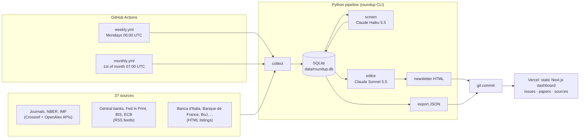

# The Research Roundup

An automated Python pipeline that collects new economics research every week from 37 sources (the top five journals, G10 and European central banks, the twelve regional Federal Reserve Banks, NBER, Brookings, the IMF and the BIS). It screens and classifies every paper for a Global Markets Research audience, and publishes a monthly email-ready newsletter alongside a web dashboard for exploring every paper behind it.

**Live**

- Dashboard: <https://research-roundup-zeta.vercel.app>
- Newsletters: [October 2026](https://research-roundup-zeta.vercel.app/newsletters/2026-10/) · [September 2026](https://research-roundup-zeta.vercel.app/newsletters/2026-09/) · [August 2026](https://research-roundup-zeta.vercel.app/newsletters/2026-08/)
- [Paper explorer](https://research-roundup-zeta.vercel.app/papers/) (919 screened papers) · [Sources and coverage](https://research-roundup-zeta.vercel.app/sources/)

**Documentation:** [docs/SOURCES.md](docs/SOURCES.md) (every source, its status and fallbacks) · [docs/METHODOLOGY.md](docs/METHODOLOGY.md) (classification, prompts, editor logic, evaluation, costs) · [docs/PLAN.md](docs/PLAN.md) (the build plan)

## At a glance

| | |
|---|---|
| **Sources** | 55 configured, 37 collected: 33 fully working, 4 partial, 18 not covered with reasons documented. Every G10 central bank, all twelve regional Feds, NBER, the IMF, the BIS and four of the five journals are fully covered. |
| **Screening** | Every paper with an abstract is scored for relevance (0–10) and tagged EM, DM or Transversal with a rationale, topics and regions, by Claude Haiku 5.5 |
| **Accuracy** | The market-focus tag agrees with a human labeller on 22 of 25 papers (88%, Cohen's kappa 0.82) |
| **Editor** | Claude Sonnet 5.5 picks 5–8 papers a month. Code checks the balance, variety and length rules, and sends violations back for revision. |
| **Output** | Table-based, inlined-CSS newsletter (600 px, mobile-friendly, no JavaScript) and a static Next.js dashboard |
| **Automation** | GitHub Actions: weekly collection and screening, monthly issue; results are committed to git and the site redeploys |
| **Cost** | About $0.30 a month in LLM calls; hosting is free |

## Architecture



- **Python does all the work.** The `roundup` package collects, screens, edits, renders and exports. It runs as scheduled jobs, so there's no always-on server.
- **SQLite is the source of truth**, committed to the repository with each run (2.2 MB for three months of data). The JSON in `web/public/data/` is only what the dashboard reads.
- **The dashboard is a static export.** Next.js renders every page at build time from that JSON (about 930 pages). Filtering and sorting happen in the browser, so there's no database or API at runtime.

## Quickstart

Requirements: [uv](https://docs.astral.sh/uv/) (it installs Python 3.12 itself) and Node.js 20.9 or later.

```bash
git clone https://github.com/Kami2Kc/research-roundup.git
cd research-roundup
cp .env.example .env            # set LLM_API_KEY and CONTACT_EMAIL (see Configuration)

cd pipeline
uv sync
uv run pytest                   # 54 offline tests: saved responses and a fake LLM, no network or API key needed
uv run roundup sources-report   # coverage and health of every source
```

The repository already contains three months of data, so you can look at the dashboard straight away:

```bash
cd ../web
npm install
npm run dev                     # http://localhost:3000
```

To run the pipeline yourself:

```bash
cd pipeline
uv run roundup collect --since 2026-10-01      # fetch new papers into data/roundup.db
uv run roundup screen --limit 20               # classify a few papers
uv run roundup build-issue --month 2026-10     # editor picks 5-8 papers; writes web/public/newsletters/2026-10.html
uv run roundup export                          # writes web/public/data/*.json

# or everything for past months in one go (issues that already exist are kept unless --rebuild)
uv run roundup backfill --from 2026-08-01 --to 2026-10-31
```

For a free dry run with placeholder LLM output, prefix any command with `LLM_PROVIDER=fake`. Placeholder results are never treated as final, so a later real run replaces them.

### Commands

| Command | What it does |
|---|---|
| `roundup collect [--since DATE] [--source ID]` | Fetch new publications (default: the last 14 days) |
| `roundup screen [--limit N] [--since DATE]` | Classify papers not yet screened (capped at `SCREEN_LIMIT` LLM calls per run) |
| `roundup build-issue --month YYYY-MM [--render-only]` | Run the editor and render the newsletter, or re-render a stored issue |
| `roundup export` | Write the dashboard's JSON |
| `roundup run-weekly` | `collect`, `screen`, `export` |
| `roundup run-monthly [--month YYYY-MM]` | `collect` from the start of the month, `screen`, `build-issue` (default: last month), `export` |
| `roundup backfill --from DATE --to DATE [--rebuild]` | Collect, screen and build issues for past months |
| `roundup sources-report [--markdown]` | Coverage and health of every source |
| `roundup eval` | Compare the model's market focus with the hand labels in `eval/labels.csv` |

## Configuration

Settings come from environment variables: a git-ignored `.env` file locally, and repository secrets in Actions. See [`.env.example`](.env.example).

| Variable | Purpose |
|---|---|
| `LLM_PROVIDER` | `anthropic` (default), or `fake` for offline runs |
| `LLM_API_KEY` | Anthropic API key |
| `LLM_SCREEN_MODEL`, `LLM_EDITOR_MODEL` | Model names (`claude-haiku-5-5`, `claude-sonnet-5-5`); never hard-coded |
| `CONTACT_EMAIL` | Contact address in the crawler's User-Agent and Crossref's `mailto` parameter |
| `SCREEN_LIMIT` | Cost guard: maximum LLM screening calls per run (default 300) |
| `RELEVANCE_THRESHOLD` | Minimum relevance score for the monthly candidate pool (default 6) |
| `SITE_URL` | The dashboard's URL, for "view online" links in the newsletter |

### Adding a source

Every source is an entry in [`config/sources.yaml`](config/sources.yaml); adding one needs no code. The collector is chosen by `method`, in order of preference: `crossref` or `openalex`, then `rss`, then `html`. For a feed:

```yaml
  - id: example_cb
    name: Example Central Bank
    group: european_ncb            # journal | g10_cb | fed_regional | european_ncb | intl_org | nber | bpea
    country_or_region: Exampleland
    method: rss
    feed_urls: ["https://www.example-cb.org/rss/working-papers.xml"]
    link_pattern: "/working-paper/"        # optional: keep only matching items from a mixed feed
    selectors:
      abstract: "div.abstract"            # optional: take the abstract from each paper's page
```

For a site without a feed, CSS selectors describe the listing page:

```yaml
    method: html
    url: https://www.example-cb.org/research/working-papers
    selectors:
      item: "li.publication"        # each paper on the page
      title: "a.title"
      date: "span.date"             # parsed from common formats; omit and papers are dated when first seen
      authors: "span.authors"
      abstract: "div.abstract"      # on each paper's own page
```

Then run `uv run roundup collect --source example_cb --since 2026-10-01` and check `roundup sources-report`. Each collector respects robots.txt and crawl delays, sends at most about one request per second per host, and retries with backoff, and one source failing never stops a run.

## Automation and deployment

Two GitHub Actions workflows run the pipeline and commit the results (the database plus the dashboard's JSON and HTML). Each commit redeploys the site on Vercel.

| Workflow | Schedule | Runs |
|---|---|---|
| [`weekly.yml`](.github/workflows/weekly.yml) | Mondays 06:00 UTC | `roundup run-weekly` |
| [`monthly.yml`](.github/workflows/monthly.yml) | 1st of the month, 07:00 UTC | `roundup run-monthly` (accepts a month when run by hand) |

Both can be started from the Actions tab (**Run workflow**). They share a concurrency group, so they never overlap, and the Actions they use are pinned to commit SHAs.

Repository secrets (Settings → Secrets and variables → Actions): `LLM_API_KEY` and `CONTACT_EMAIL` (both required), `SITE_URL` (recommended), and `VERCEL_DEPLOY_HOOK` (optional, for when pushes from the Actions bot don't trigger a deployment). The model names can be changed with the repository variables `LLM_SCREEN_MODEL` and `LLM_EDITOR_MODEL`.

**Dashboard on Vercel:** import the repository and set **Root Directory** to `web`; everything else is detected. Because the site is a static export (`output: 'export'`), any static host works; on GitHub Pages, serve the `web/out/` folder that `npm run build` produces.

## Costs

Measured on the three published months (prices checked 31 October 2026: Claude Haiku 5.5 $0.10/$0.50 per million input/output tokens, Claude Sonnet 5.5 $2/$10):

| Item | Cost |
|---|---|
| Screening | About $0.0003 a paper (about 2,100 tokens in, 150 out): **$0.07–0.10 a month** for 240–350 papers |
| Editor | **$0.17–0.29 an issue**, including any revision rounds |
| Running total | **About $0.30 a month, under $5 a year** |
| Hosting | Free: GitHub Actions (a few minutes a week) and Vercel's Hobby plan |
| Development | All LLM calls while building this, including two full re-screens during prompt development: about $1.60 |

Each run prints its token use and estimated cost, and `SCREEN_LIMIT` caps how many papers one run can send to the model.

## Design choices

**Scheduled batch jobs, data committed to git, and a static dashboard.** The pipeline runs as two scheduled GitHub Actions workflows. Each run commits the SQLite database and the dashboard's JSON back to the repository (the "git scraping" pattern), and Vercel rebuilds a fully static Next.js site from those files. This suits a one-week prototype:

- **No servers to keep running.** There's no database or API to host, patch or monitor; between runs, nothing is running.
- **Free.** Actions minutes and static hosting cost nothing at this scale, so LLM calls (about $0.30 a month) are the only running cost.
- **Every run is visible.** Each run has a log in the Actions tab and leaves a commit, so a reviewer can see exactly what changed each week, and rolling back is `git revert`.

Other choices worth knowing about:

- **APIs before scraping.** Crossref and OpenAlex come first, then publishers' own feeds, then HTML. This gave cleaner data than scrapers would have for the IMF (its RSS endpoint is gone) and NBER (its feed has no dates), both through Crossref, and for all twelve regional Feds through the Federal Reserve's own Fed in Print feeds.
- **Configuration over code.** Sources, selectors and filters live in YAML, and `docs/SOURCES.md` documents every fallback.
- **Two models, two jobs.** A cheap, fast model classifies every paper; a stronger model edits once a month. Outputs are validated against Pydantic schemas with retries, and each result stores its model and prompt version. Papers are never re-screened.
- **The editor is agentic, but code holds the rules.** The model reviews the pool and justifies its picks. Deterministic checks (balance, source and topic variety, word limits, valid IDs) send problems back for revision, and the selection rationale is published with each issue.
- **Honest limits.** Summaries are based on abstracts only, and papers without an abstract are logged and skipped. Sites that block crawlers stay blocked.
- **Testable offline.** A `FakeLLM` and saved real responses let the whole pipeline run in tests with no network or API key.

## Production path

This prototype is built to be easy to move. Ideally it would run as an extension of an existing Python backend or orchestrator, for example as scheduled jobs in the team's current service or as an Airflow DAG:

- **Orchestration.** Each job is a short sequence of plain CLI steps (`collect`, `screen`, `build-issue`, `export`) in `pipeline/src/roundup/jobs.py`, so each becomes a task in the existing scheduler. Per-source collection could fan out as parallel tasks with retries and alerting.
- **Storage.** Postgres instead of SQLite in git. The schema in `db.py` is plain SQL with no ORM, so it carries over almost unchanged, and the JSON export becomes an API or a view.
- **Dashboard.** Served from the internal web stack behind single sign-on rather than a public static host.
- **Operations.** Monitoring and alerting on source health (the `source_runs` table already records every run's outcome), LLM spend, and failed or empty issues; secrets from the firm's vault; the LLM through the approved gateway.
- **Distribution.** The newsletter HTML is already email-safe, so it can go straight into the internal mailing tool.

## Limitations and next steps

**Limitations**

- **Abstract-only.** Summaries can't go beyond what an abstract says. Most JPE papers have no abstract we can use, so JPE is only partly covered.
- **Coverage gaps.** Eighteen smaller European central banks aren't covered: their research lists are rendered by JavaScript, they have no listing at all, or they block our crawler. This includes BOFIT, the Czech National Bank and the National Bank of Poland, so EM research comes mostly from the IMF and BIS (about 10% of screened papers are EM).
- **Feed history.** Feeds only hold recent items. Several feed-based sources reach back to September but not August, so the August issue relies more on the API-backed sources.
- **Undated listings.** MNB and the BPEA page show no dates, so their papers are dated when first seen. BPEA's Fall 2026 papers predate our first run and are not in any issue.
- **Evaluation size.** The 88% agreement figure comes from one labeller and 25 papers (95% interval of roughly 70–96%), and relevance scores haven't been evaluated against human judgement.
- **No cross-source deduplication.** The same paper published by two sources, such as an NBER working paper later printed in a journal, counts twice in the statistics. The editor spots these within an issue: August's rationale notes a Fed paper published by two banks.

**Next steps**

1. Email delivery of each issue, as an optional step in the monthly workflow.
2. Cross-source deduplication by DOI and normalised title.
3. Screening prompt v4, aimed at the Transversal boundary where all three evaluation disagreements sat, measured on a fresh labelled set.
4. More EM coverage: BPEA conference pages, Eesti Pank's embedded data, and other EM-focused research series.
5. Shareable filters in the paper explorer (filters in the URL).

## Repository layout

```
config/sources.yaml        every source: method, URLs, selectors, filters, notes
pipeline/                  Python package `roundup` (uv, Python 3.12+)
  src/roundup/
    cli.py                 Typer CLI
    jobs.py                weekly, monthly and backfill jobs
    collectors/            crossref.py, openalex.py, rss.py, html.py, base.py (polite HTTP client)
    screening.py           relevance and market-focus classification (prompt, schema)
    editor.py              monthly selection and write-ups (prompts, rule checks, revisions)
    newsletter.py          renders the email HTML (templates/newsletter.html.j2)
    export.py  health.py   dashboard JSON; source health
    db.py  llm.py  models.py  config.py  eval.py
  tests/                   54 offline tests, fixtures saved from real responses
data/roundup.db            SQLite database (committed; the source of truth)
web/                       Next.js dashboard (static export)
  public/data/             JSON written by `roundup export`
  public/newsletters/      one HTML file per issue
eval/                      hand labels and evaluation results
docs/                      PLAN.md, SOURCES.md, METHODOLOGY.md
.github/workflows/         weekly.yml, monthly.yml
```
